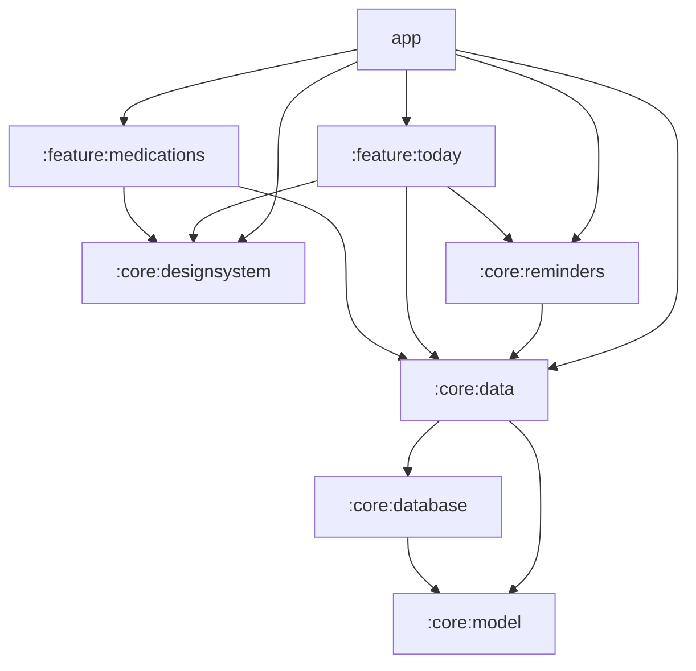

# Kairo

[](https://github.com/Sravanthipanga/kairo-android/actions/workflows/ci.yml)

**The right dose, at the right moment.**

Kairo is an offline-first Android medication companion built with Kotlin and Jetpack Compose.

The name comes from the Greek *kairos*, meaning "the right moment". Kairo learns when you actually take your doses and nudges you at the right moment instead of at a fixed alarm time.

> 🚧 Under active development. See the roadmap below.

## Roadmap

- [x] Project skeleton: multi-module Gradle build, Compose, Hilt, Room, CI
- [x] Medications: add and edit medications, schedules, today's doses, dose log
- [x] Reminders: exact alarms with "Taken" and "Snooze" notification actions
- [x] Adaptive timing: suggests moving a reminder when you consistently take a dose at a different time
- [ ] Health Connect, home-screen widget, biometric lock
- [ ] Sync backend exposing FHIR R4 `MedicationRequest`
- [ ] Tests, screenshots, Play Store release

## How adaptive timing works

Kairo compares each reminder with when you actually took the dose over the last 14 days. It suggests a change only when there is a clear, consistent habit, and **it never changes a schedule without your approval**.

| Guard rail | Rule |
|---|---|
| Enough evidence | At least 5 taken doses for that reminder |
| A real habit, not noise | The typical difference is at least 15 minutes |
| Consistent | The middle half of your dose times fall within 30 minutes of each other |
| One-off days ignored | Doses taken more than 3 hours from the reminder are left out |
| Small steps | One suggestion moves a reminder at most 60 minutes, rounded to 5 |
| Safe boundaries | Never crosses midnight or collides with another reminder |
| Respects "Not now" | A dismissed suggestion stays quiet for 14 days |

The logic is a pure Kotlin function in `:core:model` with its own unit tests.

## Tech stack

Kotlin · Jetpack Compose (Material 3) · Coroutines & Flow · Hilt · Room · Navigation Compose · AlarmManager & notifications · JUnit, Turbine · GitHub Actions

## Architecture

Kairo is split into modules so features stay independent and the domain logic is testable on the plain JVM.



| Module | Responsibility |
|---|---|
| `:app` | Application, activity, bottom navigation, navigation host, Hilt entry point |
| `:feature:today` | Today's doses: mark taken or skipped, undo, overdue state, daily progress, timing suggestions |
| `:feature:medications` | Medication list and the add/edit editor with validation and time pickers |
| `:core:data` | Repositories. The local database is the single source of truth (offline-first) |
| `:core:database` | Room database, DAOs, entities, exported schemas and auto-migrations |
| `:core:model` | Pure Kotlin domain models and logic (`Medication`, `DoseEvent`, daily schedule, adaptive timing) |
| `:core:reminders` | Exact alarms per reminder slot, notifications with Taken and Snooze, rescheduling after reboot or time-zone change |
| `:core:designsystem` | Kairo's Material 3 theme and colours |
| `:core:testing` | Shared test doubles (fake repositories) and a coroutine test rule |
| `build-logic` | Gradle convention plugins shared by every module |

## Build and run

Requires JDK 17 and the Android SDK (API 35).

```bash
./gradlew assembleDebug        # build the app
./gradlew testDebugUnitTest    # run unit tests
./gradlew lintDebug            # run Android lint
```

Or open the project in Android Studio and run the `app` configuration.

## License

[MIT](LICENSE)
