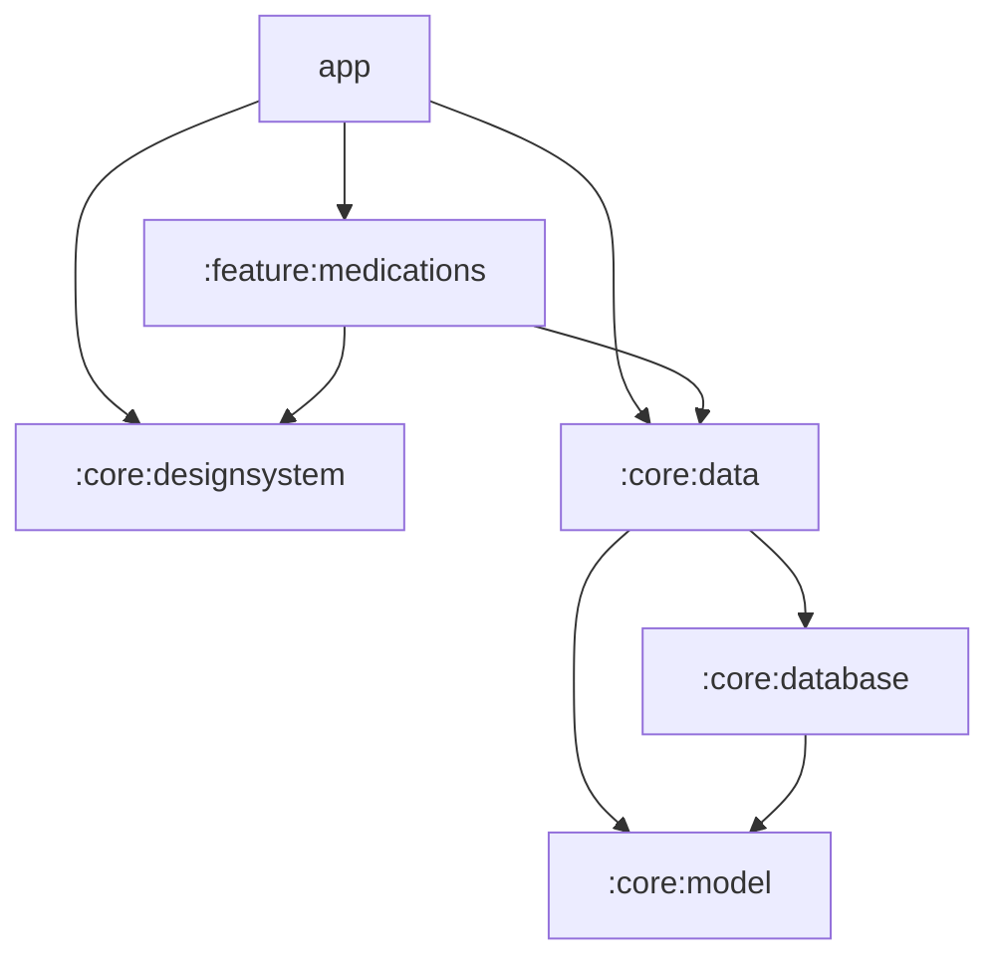

# Kairo

[](https://github.com/Sravanthipanga/kairo-android/actions/workflows/ci.yml)

**The right dose, at the right moment.**

Kairo is an offline-first Android medication companion built with Kotlin and Jetpack Compose.

The name comes from the Greek *kairos*, meaning "the right moment". Kairo learns when you actually take your doses and nudges you at the right moment instead of at a fixed alarm time.

> 🚧 Under active development. See the roadmap below.

## Roadmap

- [x] Project skeleton: multi-module Gradle build, Compose, Hilt, Room, CI
- [ ] Medications: add and edit medications, schedules, dose log
- [ ] Reminders: exact alarms with "Taken" and "Snooze" notification actions
- [ ] Adaptive timing: reminders that shift toward when you actually take your doses
- [ ] Health Connect, home-screen widget, biometric lock
- [ ] Sync backend exposing FHIR R4 `MedicationRequest`
- [ ] Tests, screenshots, Play Store release

## Tech stack

Kotlin · Jetpack Compose (Material 3) · Coroutines & Flow · Hilt · Room · Navigation Compose · JUnit, Turbine · GitHub Actions

## Architecture

Kairo is split into modules so features stay independent and the domain logic is testable on the plain JVM.



| Module | Responsibility |
|---|---|
| `:app` | Application, activity, navigation host, Hilt entry point |
| `:feature:medications` | Medication list screen and its `ViewModel` |
| `:core:data` | Repositories. The local database is the single source of truth (offline-first) |
| `:core:database` | Room database, DAOs, entities, exported schemas |
| `:core:model` | Pure Kotlin domain models (`Medication`, `DoseEvent`) |
| `:core:designsystem` | Kairo's Material 3 theme and colours |
| `build-logic` | Gradle convention plugins shared by every module |

## Build and run

Requires JDK 17 and the Android SDK (API 35).

```bash
./gradlew assembleDebug        # build the app
./gradlew testDebugUnitTest    # run unit tests
./gradlew lintDebug            # run Android lint
```

Or open the project in Android Studio and run the `app` configuration.

## License

[MIT](LICENSE)
