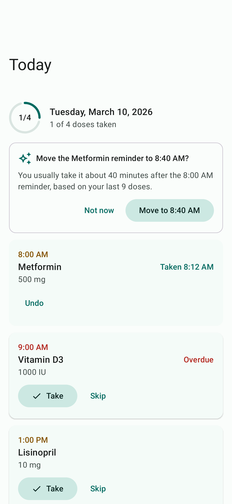
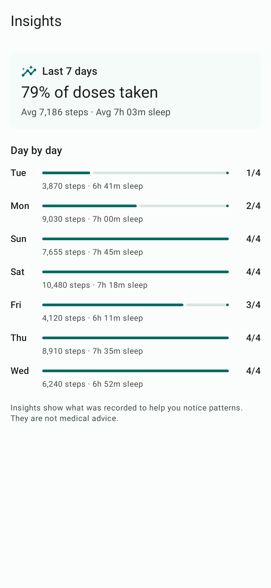
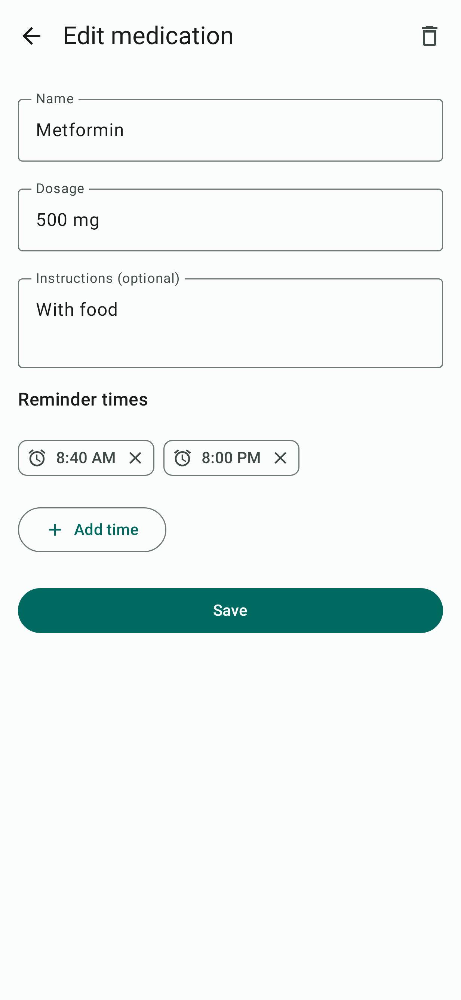
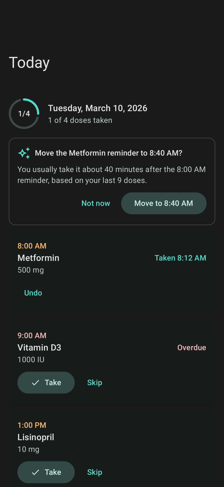
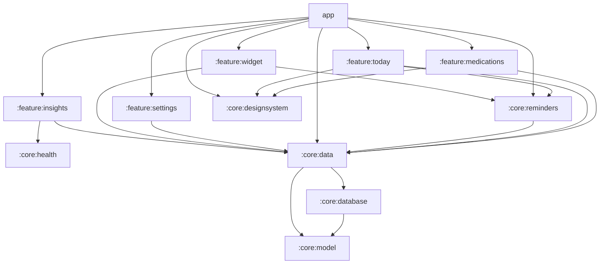

# Kairo

[](https://github.com/Sravanthipanga/kairo-android/actions/workflows/ci.yml)

**The right dose, at the right moment.**

Kairo is an offline-first Android medication companion built with Kotlin and Jetpack Compose.

The name comes from the Greek *kairos*, meaning "the right moment". Kairo learns when you actually take your doses and nudges you at the right moment instead of at a fixed alarm time.

<p align="center">
  
  
  
  
</p>

## Roadmap

- [x] Project skeleton: multi-module Gradle build, Compose, Hilt, Room, CI
- [x] Medications: add and edit medications, schedules, today's doses, dose log
- [x] Reminders: exact alarms with "Taken" and "Snooze" notification actions
- [x] Adaptive timing: suggests moving a reminder when you consistently take a dose at a different time
- [x] App lock: fingerprint, face or screen lock, plus private notifications
- [x] Home-screen widget: next dose with a one-tap Taken button
- [x] Insights: 7-day dose adherence, with steps and sleep from Health Connect
- [ ] Sync backend exposing FHIR R4 `MedicationRequest`
- [x] Release setup: signed builds in CI, privacy policy, Play Store listing
- [x] Screenshots generated from code (Roborazzi)
- [ ] Play Store release

## How adaptive timing works

Kairo compares each reminder with when you actually took the dose over the last 14 days. It suggests a change only when there is a clear, consistent habit, and **it never changes a schedule without your approval**.

| Guard rail | Rule |
|---|---|
| Enough evidence | At least 5 taken doses for that reminder |
| A real habit, not noise | The typical difference is at least 15 minutes |
| Consistent | The middle half of your dose times fall within 30 minutes of each other |
| One-off days ignored | Doses taken more than 3 hours from the reminder are left out |
| Small steps | One suggestion moves a reminder at most 60 minutes, rounded to 5 |
| Safe boundaries | Never crosses midnight or collides with another reminder |
| Respects "Not now" | A dismissed suggestion stays quiet for 14 days |

The logic is a pure Kotlin function in `:core:model` with its own unit tests.

## Privacy

Medication history is health data, so Kairo treats it that way:

- **On-device only.** Data is stored locally and excluded from cloud backups and device transfers.
- **App lock (optional).** Requires a fingerprint, face or the device screen lock. It re-locks after 30 seconds in the background, and the device PIN always works as a fallback.
- **No peeking.** With app lock on, Kairo is hidden from screenshots and the recent-apps preview.
- **Private notifications.** On a locked phone, reminders say "Time for your medication" without naming it.
- **Read-only health data.** Kairo reads only steps and sleep from Health Connect, never writes, and never sends them off the phone.
- **Private widget.** With app lock on, the home-screen widget shows only the time of the next dose.

## Tech stack

Kotlin · Jetpack Compose (Material 3) · Coroutines & Flow · Hilt · Room · Navigation Compose · AlarmManager & notifications · BiometricPrompt · DataStore · Glance widgets · Health Connect · JUnit, Turbine · GitHub Actions

## Architecture

Kairo is split into modules so features stay independent and the domain logic is testable on the plain JVM.



| Module | Responsibility |
|---|---|
| `:app` | Application, activity, bottom navigation, navigation host, app lock, Hilt entry point |
| `:feature:today` | Today's doses: mark taken or skipped, undo, overdue state, daily progress, timing suggestions |
| `:feature:insights` | Last 7 days: dose adherence per day, plus steps and sleep when Health Connect is connected |
| `:feature:widget` | Glance home-screen widget: next dose, overdue state, Taken button, daily progress |
| `:feature:settings` | Settings: app lock switch and privacy information |
| `:feature:medications` | Medication list and the add/edit editor with validation and time pickers |
| `:core:data` | Repositories. The local database is the single source of truth (offline-first) |
| `:core:database` | Room database, DAOs, entities, exported schemas and auto-migrations |
| `:core:model` | Pure Kotlin domain models and logic (`Medication`, `DoseEvent`, daily schedule, adaptive timing) |
| `:core:health` | Read-only Health Connect access (steps and sleep), behind an interface for testing |
| `:core:reminders` | Exact alarms per reminder slot, notifications with Taken and Snooze, rescheduling after reboot or time-zone change |
| `:core:designsystem` | Kairo's Material 3 theme and colours |
| `:core:testing` | Shared test doubles (fake repositories) and a coroutine test rule |
| `build-logic` | Gradle convention plugins shared by every module |

## Build and run

Requires JDK 17 and the Android SDK (compiles against API 36, targets API 35).

```bash
./gradlew assembleDebug        # build the app
./gradlew testDebugUnitTest    # run unit tests
./gradlew lintDebug            # run Android lint
./gradlew recordRoborazziDebug # regenerate the screenshots in docs/screenshots
```

The screenshots are rendered from the real Compose screens on the JVM with Robolectric and Roborazzi, so they always match the code. During normal test runs the same tests run as rendering checks without writing files.

Or open the project in Android Studio and run the `app` configuration.

## Releasing

Signed Play Store builds are produced by the **Release** workflow from GitHub secrets. The signing key never enters the repository. See [RELEASING.md](RELEASING.md), the [privacy policy](docs/privacy-policy.md) and the [Play Store listing](docs/play-store-listing.md).

## License

[MIT](LICENSE)
